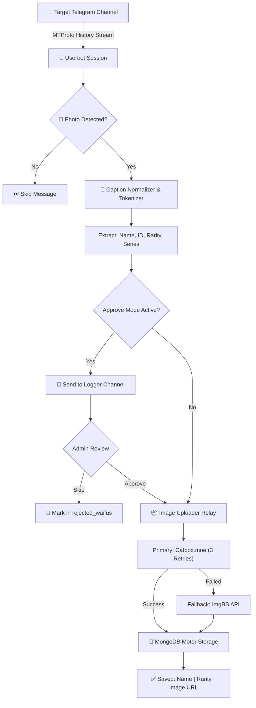

<div align="center">


<p align="center">
  
</p>

[](https://www.python.org/)
[](https://docs.pyrogram.org/)
[](https://motor.readthedocs.io/)
[](https://www.docker.com/)
[](./LICENSE)
[](https://t.me/Zcziiy)

</div>

---

## ⚡ What is WAIFUSCRPER?

**WAIFUSCRPER** is a high-throughput, enterprise-grade Telegram scraper engine built on **Pyrogram v2** and **MongoDB Motor**. It enables users to stream entire public or private Telegram channels via dedicated userbot MTProto sessions, parse stylized anime captions, upload uncompressed media to **Catbox / ImgBB**, and save structured records directly to MongoDB — built to feed anime bots like **YUKIWAFUS**.

---

## ✨ Key Features

- ⚡ **Userbot MTProto Channel Streaming**: Scrape any public or private channel/chat using your own Pyrogram string session.
- 🔮 **Smart Caption Tokenizer**: Built-in Unicode NFKD normalization parses stylized fonts, bold/italic symbols, extracting:
  - Waifu Character Name
  - Sequential ID (or auto-assigned +1)
  - Rarity Tier (`Celestial`, `Mythic`, `Legendary`, `Rare`, `Common`)
  - Anime / Series Name
  - Contributor credit (`Added by: ...`)
- 📦 **Dual-Hoster Image Relay**:
  - **Primary**: [Catbox.moe](https://catbox.moe) with 30s timeout and 3x auto-retry.
  - **Fallback**: [ImgBB API](https://imgbb.com) multipart base64 uploader.
- 🛡️ **FloodWait Shield**: Exponential backoff and jittered pacing protect userbot sessions against Telegram rate limits.
- 🎛️ **Dual Operating Modes**:
  - **Auto Mode**: Headless, real-time automated ingestion to MongoDB.
  - **Approve Mode**: Sends candidate waifus to a dedicated logger group with inline buttons (`✅ Approve` / `❌ Skip` / `📨 View in Channel`).
- 🔐 **In-Chat String Session Generator**: Run `/setsession` directly inside Telegram with 2FA support and 120s step timeouts.
- 👥 **Dynamic Sudo RBAC**: Real-time permission system stored in MongoDB (`/addsudo`, `/rmsudo`, `/sudolist`).
- 🖥️ **Interactive Web Studio**: Built-in [`index.html`](./index.html) visualizer and live caption playground.

---

## 🔄 Architecture & Data Flow



---

## 🚀 Quick Start & Deployment

### Method 1: Local / VPS (Recommended)

```bash
# 1. Clone repository
git clone https://github.com/TOXICXD43/WAIFUSCRPER-.git
cd WAIFUSCRPER-

# 2. Automated environment setup
bash setup

# 3. Configure credentials
cp sample.env .env
nano .env

# 4. Start scraper bot
bash start
# Or 24/7 background worker using PM2:
pm2 start "python3 -m WAIFUSCRPER" --name waifuscrper
pm2 save
```

### Method 2: Docker & Docker Compose

```bash
# 1. Configure environment
cp sample.env .env
nano .env

# 2. Launch container stack (Bot + MongoDB 6.0)
docker compose up -d --build

# 3. View live logs
docker compose logs -f waifuscrper
```

### Method 3: One-Click Cloud PaaS

| Platform | Deployment Type | Template / Config |
| :--- | :--- | :--- |
| **Heroku** | Worker Dyno | [`Herku.yml`](./Herku.yml) / [`Procfile`](./Procfile) |
| **Render** | Background Worker | [`Rander.yml`](./Rander.yml) |
| **Railway / VPS** | Docker Container | [`Dockerfile`](./Dockerfile) |

---

## ⚙️ Environment Configuration

Create a `.env` file in the project root:

| Variable | Required | Default | Description |
| :--- | :---: | :---: | :--- |
| `BOT_TOKEN` | **Yes** | — | Telegram Bot token from [@BotFather](https://t.me/BotFather) |
| `API_ID` | **Yes** | — | Telegram API ID from [my.telegram.org](https://my.telegram.org) |
| `API_HASH` | **Yes** | — | Telegram API Hash from [my.telegram.org](https://my.telegram.org) |
| `OWNER_ID` | **Yes** | — | Numeric Telegram User ID of the bot master |
| `MONGO_URI` | **Yes** | — | MongoDB connection URI (`mongodb+srv://...`) |
| `DB_NAME` | No | `waifuscrper` | Database name |
| `COLLECTION_NAME` | No | `waifus` | Active waifus collection |
| `LOGGER_ID` | No | — | Telegram Group/Channel ID for approval previews (`-100xxx`) |
| `TARGET_CHANNEL` | No | — | Username (`@channel`) or numeric ID to scrape |
| `STRING_SESSION` | No | — | Pyrogram v2 string session (or generate via `/setsession`) |
| `CATBOX_HASH` | No | — | Catbox account user hash for non-expiring hosting |
| `IMGBB_KEY` | No | — | ImgBB API Key for automatic fallback upload |
| `APPROVE_MODE` | No | `false` | `true` for manual review, `false` for instant auto-save |

---

## 🤖 Command Reference

### User & General Commands
| Command | Permission | Description |
| :--- | :---: | :--- |
| `/start` | Everyone | Opens the interactive main dashboard with inline buttons |
| `/help` | Everyone | Interactive multi-page documentation guide |
| `/cancel` | Everyone | Aborts any active session generation or multi-step wizard |
| `/setsession` | Owner | Interactive in-chat Pyrogram String Session generator |

### Scraper Control
| Command | Permission | Description |
| :--- | :---: | :--- |
| `/wstart` | Sudo / Owner | Initiates channel history traversal and scraper worker |
| `/wstop` | Sudo / Owner | Safely halts the running scraper session |

### Bot & Sudo Management
| Command | Permission | Description |
| :--- | :---: | :--- |
| `/config` | Sudo / Owner | Interactive inline menu for all runtime settings |
| `/addsudo <user_id>` | Owner Only | Grants sudo permissions to a user ID or reply |
| `/rmsudo <user_id>` | Owner Only | Revokes sudo privileges |
| `/sudolist` | Sudo / Owner | Displays all authorized sudo operators from MongoDB |

---

## 🍃 MongoDB Schema

Each scraped character is validated and saved as an atomic document:

```json
{
  "name": "Nobara Kugisaki",
  "img_url": "https://files.catbox.moe/sjm5sv.jpg",
  "rarity": "Celestial",
  "series": "Jujutsu Kaisen",
  "event_tag": "standard",
  "source_message_id": 3793,
  "added_by": "Gun Park",
  "id": "3793",
  "waifu_id": "3793",
  "Date": "09/10/2026"
}
```

---

## 🧪 Developer Utilities & Examples

The repository includes standalone scripts in the [`examples/`](./examples) directory:

```bash
# 1. Test regex caption parsing with sample captions:
python3 examples/test_caption_parser.py

# 2. Benchmark Catbox & ImgBB upload latency:
python3 examples/test_image_upload.py

# 3. Export all scraped MongoDB waifus to JSON:
python3 examples/export_waifus.py my_export.json
```

---

## 🛡️ Anti-Ban & Operational Best Practices

> [!CAUTION]
> **Never use your personal Telegram account as the scraper userbot.**
> - Telegram monitors excessive channel reads on newly registered accounts.
> - Always use a dedicated burner/spare account.
> - Keep `sleep_threshold` at default (`60s`) to ensure graceful backoff when rate-limited.

---

## 📄 License & Attribution

This project is licensed under the **MIT License** — see the [`LICENSE`](./LICENSE) file for details.

Copyright © 2026 **[TOXICXD43](https://github.com/TOXICXD43)** & **[SUDEEPBOTS](https://github.com/SUDEEPBOTS)**. All Rights Reserved.

For queries and support: **[@Zcziiy on Telegram](https://t.me/Zcziiy)**
